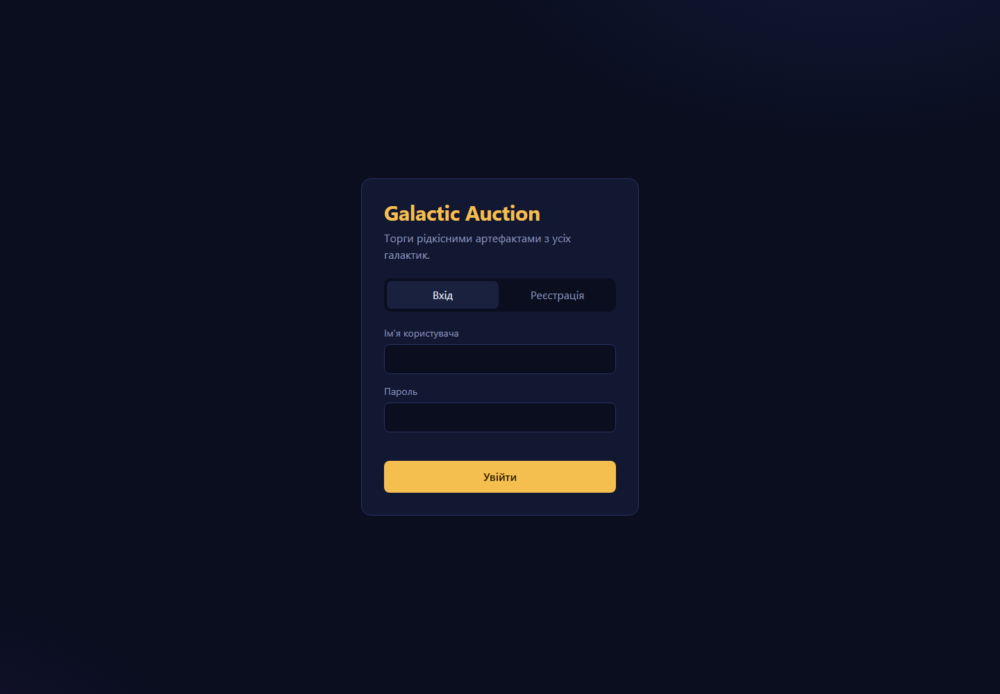

# DVO-L3-7F2A91
# Звіт — лабораторна робота №3, Технології DevOps

Дата виконання: 15 листопада 2026 року. Застосунок: **Galactic Auction**.

## Мета та середовище

Розгорнути власний FastAPI-застосунок із PostgreSQL у Kubernetes та перевірити
керування його життєвим циклом. Використано Windows 11, Docker Desktop
(Linux containers), minikube 1.39.0, Kubernetes 1.37.0 та драйвер docker.
Створено окремий profile і namespace `galactic-auction`. Увімкнено
metrics-server та ingress. Застосунок доступний через NodePort Service;
для браузера Windows використано port-forward на `127.0.0.1:8080`.

## Реалізація

У `k8s/` містяться 10 вручну підготовлених маніфестів: Namespace, ConfigMap,
Secret, PVC, два Deployment, два Service, Job міграцій та Pod для HTTP-перевірок.
Deployment застосунку має 2 репліки, requests/limits, startup/liveness/readiness
probes та RollingUpdate з `maxUnavailable: 0`, `maxSurge: 1`.
PostgreSQL використовує PVC 1 GiB. Міграції виконує окремий Job; вебсервери
очікують готової схеми через init containers.

Зібрано й завантажено в minikube `galactic-auction:1.0.0` та
`galactic-auction:1.1.0`. Версія закріплена в образі через build argument,
відображається в `/lab/info`, Swagger та HTTP-заголовку `X-App-Version`.
`X-Pod-Name` і `/lab/info` дозволяють визначити репліку, що обробила запит.
Реальні секрети та файли `.env` в образ не копіюються.

## Пункт 5 — розгортання

Всі об'єкти застосовано однією командою `kubectl --context galactic-auction apply -f k8s/`.
Підтверджено готовність Deployment застосунку 2/2 та PostgreSQL 1/1,
стан PVC `Bound`, завершення Job міграцій `Complete`.
Через `kubectl exec` отримано `APP_ENV=sandbox`, назву застосунку,
`POSTGRES_HOST=postgres`; підтверджено непорожні POSTGRES_PASSWORD і SECRET_KEY.

[HTTP-перевірки](evidence/http-checks.txt) підтверджують HTTP 200 для `/`,
`/docs`, `/health`, `/health/db`, `/lab/info`. Навчальний користувач admin
успішно увійшов; `/users/me` підтвердив роль admin. Сторінку відкрито в
headless Edge, скриншот перевірено візуально:

## Пункт 6 — життєвий цикл

Детальний вивід команд: [фінальна демонстрація](evidence/20261115-230533-demo.txt).

- Самовідновлення: після видалення `auction-5846964cdd-bwsks` створено
  `auction-5846964cdd-84bbl`; Deployment повернувся до готового стану.
- Масштабування: кількість реплік збільшено до 3. За 15 секунд виконано
  73 запити без помилок: под `k85x9` обробив 18, `lvssc` — 39, `84bbl` — 16.
  Розподіл не зобов'язаний бути рівномірним, але запити отримали всі три репліки.
- Rolling update: образ app змінено на 1.1.0, `rollout status` показав
  послідовну заміну реплік, після чого виконано `rollout history` та `rollout undo`.
- Доступність: окремий Pod надсилав нові HTTP-з'єднання до ClusterIP Service
  під час зміни версії. У [фінальному 60-секундному вимірюванні](evidence/20261115-230533-availability.txt)
  зафіксовано 293 відповіді, 0 помилок; 125 відповідей від 1.0.0 та 168 від 1.1.0.

Це експериментальна перевірка HTTP-доступності у зазначеному інтервалі,
а не гарантія відсутності збоїв за будь-яких умов. Наявний in-memory WebSocket
broadcast проєкту не синхронізований між репліками.

## Пункт 7 — діагностика

Навмисно встановлено `galactic-auction:does-not-exist-lab3`. Спостережено
`ImagePullBackOff`; `describe pod` і Events показали невдале завантаження
образу та `pull access denied`. Робочі репліки продовжували обслуговувати запити.
Отримано логи застосунку, виконано команди всередині контейнера.

Окремо виконано справжній інтерактивний `kubectl exec -it ... -- sh`:
[збережений вивід](evidence/interactive-shell.txt) містить `id`, `hostname`,
версію 1.0.0 та робочий каталог `/code`.

Після діагностики встановлено правильний образ 1.0.0 та повернуто 2 репліки.

## Особливості виконання

Початковий запуск зупинився через нестачу місця для кешу minikube на C:.
Кеш перенесено конфігурацією MINIKUBE_HOME на диск проєкту.
Docker було відновлено після збою службового сокета; образи й дані не скидалися.
У сценаріях виправлено передачу `--` і списків ресурсів через PowerShell-функцію,
а також запис native stdout у transcript. Наведені докази отримано живими
командами; неповні налагоджувальні записи не використовуються як підтвердження.

У додатку А є несумісна з Kubernetes вимога кириличного label value.
Використано допустиме `mascot: kabachok`, annotation `devops-lab/mascot-approved`
і українське значення в annotation Namespace. Повний порядок запуску,
параметри конфігурації та пояснення цього відхилення наведено в [README](README.md).

## Висновок

Застосунок описано декларативними маніфестами та розгорнуто в локальному
Kubernetes із постійним сховищем БД. Перевірено самовідновлення, масштабування,
rolling update, історію й відкат, діагностику помилкового образу та відновлення.
